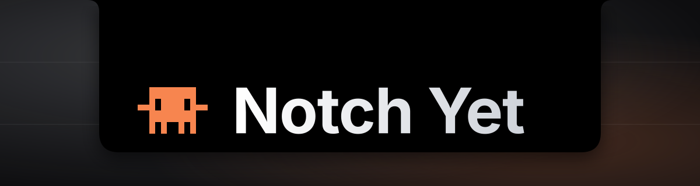
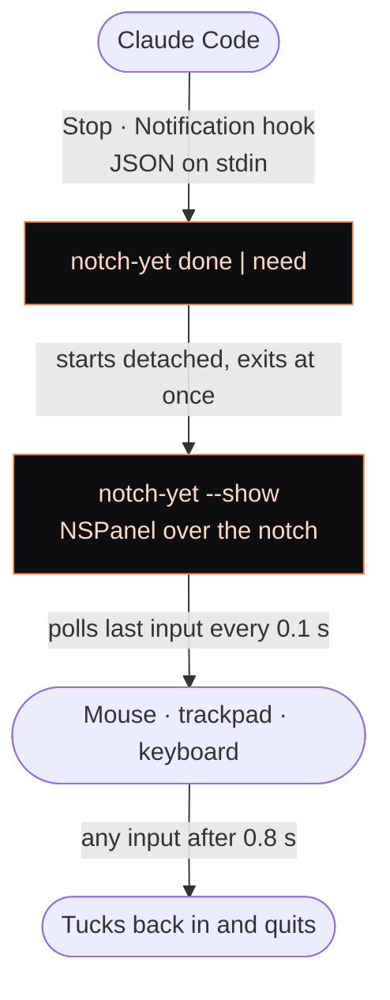

<p align="center">
  
</p>

<p align="center">
  
  
  
  
  
</p>

Your MacBook's notch tells you when Claude Code is done. When Claude finishes,
or stops to ask for a permission, the notch grows into a black panel and
Clawd pops out of it: **Claude is done**, or **Claude needs you**. Touch the
mouse, the trackpad or a key and it tucks back in.

Nothing stays running. No app in the menu bar, no Dock icon, nothing
eating memory while you wait. A Claude Code hook starts it, it shows itself
and it quits.

<p align="center">
  
</p>

## Index

- [Why](#why)
- [Installation](#installation)
- [Usage](#usage)
- [Settings](#settings)
- [Tested on](#tested-on)
- [How it fits together](#how-it-fits-together)
- [Known limitations](#known-limitations)
- [License](#license)

## Why

You send Claude off on a long task, switch to the browser, and forget about
it. Ten minutes later you come back to find it's been waiting for a
permission since minute two. Notifications get lost among all the others,
and sounds get lost if you're wearing headphones for something else.

The notch is right in the middle of where you're looking, and it's the one
spot on the screen nothing else uses:

- **Hard to miss, easy to dismiss.** It stays until you touch something,
  so you see it when you come back. Move the mouse and it's gone.
- **Two different messages.** "Done" and "needs you" aren't the same
  thing: the second one says what Claude is waiting for, in orange.
- **Costs nothing while idle.** There's no background process. Each
  notification is a fresh process that lives a few seconds.
- **No permissions.** It doesn't need Accessibility, Input Monitoring or
  anything else: it only asks macOS how long ago the last input was.

## Installation

### As a Claude Code plugin (recommended)

Inside Claude Code:

```text
/plugin marketplace add alexcalatyd/NotchYet
/plugin install notch-yet@notch-yet
```

That's all: the plugin brings the hooks with it, and a ready-built
universal binary (Apple Silicon and Intel). New sessions will use it. To
remove it, `/plugin uninstall notch-yet`.

### With Homebrew

```sh
brew tap alexcalatyd/tap
brew trust alexcalatyd/tap   # Homebrew asks you to trust third-party taps once
brew install alexcalatyd/tap/notch-yet
notch-yet install-hooks
```

`install-hooks` adds the two hooks to `~/.claude/settings.json` (it keeps a
copy in `settings.json.bak`). `notch-yet uninstall-hooks` takes them out.

### From source

You need the Xcode command line tools (`xcode-select --install`):

```sh
git clone https://github.com/alexcalatyd/NotchYet.git
cd NotchYet
./build.sh --install
```

That builds `bin/notch-yet`, copies it to `~/.local/bin` and adds the hooks.

## Usage

There's nothing to do: keep using Claude Code as usual.

| When | You see |
|---|---|
| Claude finishes its turn | **Claude is done** and the project's folder, with Clawd hopping |
| Claude asks for a permission or a question | **Claude needs you** and what it's waiting for, with Clawd waving |

It hides when you move the mouse, click, scroll or press a key. Anything
during the first 0.8 s doesn't count, so it won't vanish just because you
were already moving. A new notification replaces the one on screen instead
of stacking.

You can also show it yourself, which is handy for scripts:

```sh
notch-yet done                  # "Claude is done"
notch-yet need                  # "Claude needs you"
notch-yet done "Build finished" # any title you like
```

The text follows your system's language (English or Spanish).

## Settings

Set them as environment variables, for example in the `env` block of
`~/.claude/settings.json`:

```json
{
  "env": {
    "NOTCH_YET_SOUND": "Glass"
  }
}
```

| Variable | Default | What it does |
|---|---|---|
| `NOTCH_YET_LANG` | your system's | `en` or `es` |
| `NOTCH_YET_SOUND` | off | Plays a system sound, any name from `/System/Library/Sounds` (`Glass`, `Pop`, `Hero`…) |
| `NOTCH_YET_TIMEOUT` | `3600` | Seconds before it hides by itself if you're away |

## Tested on

> [!IMPORTANT]
> Notch Yet has only been tested on **one Mac**: a **MacBook Air 13" with
> M4 (2025), on macOS 27**. It works there. It should work on any Mac with
> a notch, and on Macs without one (it shows as a black tab hanging from
> the top of the screen), on Intel and on external displays, but I can't
> promise it, because I haven't been able to try it. If it looks wrong on
> yours, please [open an issue](https://github.com/alexcalatyd/NotchYet/issues)
> with your model and a screenshot.

## How it fits together



- `Sources/main.swift` — the whole thing in one file: the launcher, the
  panel, the notch shape, Clawd and the hook installer. Compiled with
  `swiftc`, no Xcode project.
- `bin/notch-yet` — the ready-built universal binary the plugin uses.
- `hooks/hooks.json` and `.claude-plugin/` — the plugin: the two hooks and
  its manifest.
- `build.sh` — builds `bin/notch-yet`; `--install` also copies it to
  `~/.local/bin` and adds the hooks.
- `tools/` — `icon.swift` draws the plugin icon; `demo-backdrop.swift`
  covers the top of the screen with a neutral background to record the
  demo.

<details>
<summary><b>Why it quits straight away when the hook calls it</b></summary>
<br>

Claude Code waits for a hook's command to finish. So `notch-yet done` only
reads the hook's JSON from stdin (to get the project folder and the
message), starts a second copy of itself with `--show` in its own session,
with no pipes attached, and exits. Claude carries on at once; the second
copy draws the notch.

</details>

<details>
<summary><b>How it knows you touched something, without permissions</b></summary>
<br>

Watching the mouse or the keyboard directly needs Accessibility or Input
Monitoring. Notch Yet doesn't watch them: every tenth of a second it asks
`CGEventSource.secondsSinceLastEventType` how long ago the last input of
any kind was. If that's more recent than when the notch appeared, you're
back.

</details>

<details>
<summary><b>How it fits the notch</b></summary>
<br>

macOS reports the area on each side of the notch
(`auxiliaryTopLeftArea` and `auxiliaryTopRightArea`) and its height
(`safeAreaInsets.top`). The panel starts at exactly that size, in pure
black, and grows with a spring. A soft black halo around it hides the
seam between the screen's black and the notch itself.

</details>

## Known limitations

- **Tested on a single Mac** (see [Tested on](#tested-on)).
- On LCD screens, like the MacBook Air's, the screen's black is never as
  deep as the notch's: the backlight is always on. On mini-LED (MacBook Pro)
  it blends in better.
- It shows on the screen with the notch, or on the main screen if there
  isn't one; not on every display at once.
- It also shows for non-interactive runs (`claude -p`), since those fire
  the same hook.

## License

MIT — see [LICENSE](LICENSE).

Clawd and Claude are Anthropic's. Notch Yet is a personal project and
isn't affiliated with or endorsed by Anthropic.
